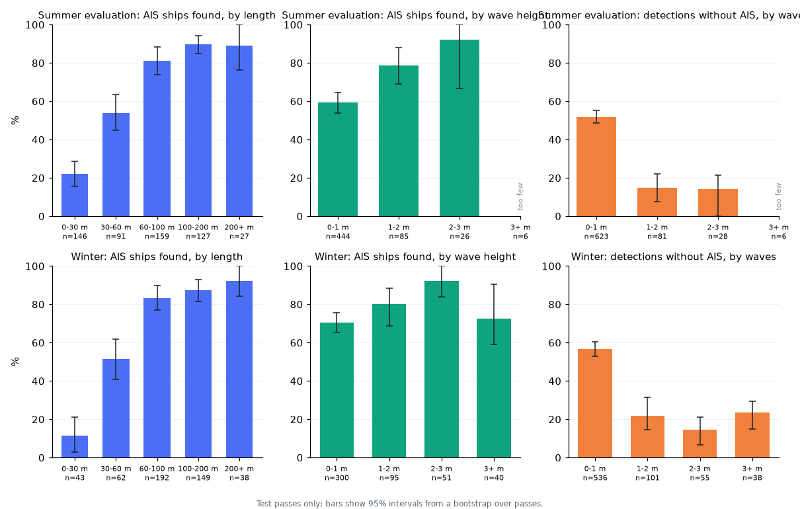
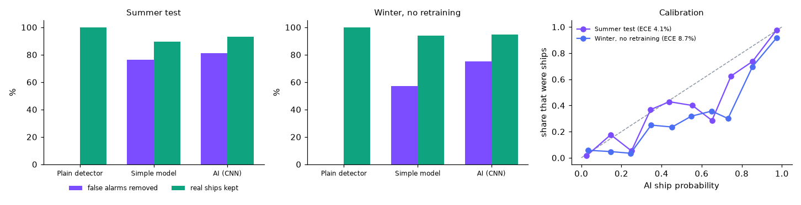

# Ships, radar and sea state off western Norway

**Live demo: https://maritime-satellite-pipeline.azurewebsites.net**

A set of data pipelines (ETL: extract, transform, load) for geospatial data and environmental data off
Bergen and Fedje. It ingests free satellite imagery (radar, optical and sea temperature), atmospheric data
(wind, weather forecasts), oceanographic data (waves) and ship positions (AIS), finds ships in the radar
images, checks them against AIS, and catalogues every product it makes.
<!-- table:summary -->
| Radar passes | AIS ships found by radar | False alarms removed by the AI (summer test, winter) | Real ships the AI keeps (summer test, winter) |
|---:|---:|---:|---:|
| 42 | 69% | 81%, 75% | 93%, 95% |
<!-- /table:summary -->



## The question

**How reliably does free satellite radar see ships along the Norwegian coast, and how do wind, waves
and ship size change that?**

Radar satellites see through clouds and at night, which makes them the obvious tool for anyone who
needs to know what is at sea and in what weather: shipping, coastal authorities, search and rescue.
SAR, synthetic aperture radar, is a satellite radar that sends microwaves down and records the echo.
Steel ships echo brightly against the darker sea. Wind and waves roughen the sea surface and make the
background brighter, so small ships can disappear in rough weather. This project measures how much in
two seasons: every selected Sentinel-1 pass from 5 August to 30 September 2026 (summer), and 18 winter
passes from 1 December 2025 to 15 March 2026, chosen by sea state before download so that stormy,
moderate and calm seas are all covered. Each pass is matched against the ships that reported their
position. Winter is a second held-out test: every setting and the AI were fixed on summer data and
used unchanged.

Short answers (test passes only: the summer evaluation passes and the winter passes; 95% intervals from
a bootstrap over passes):

<!-- table:headline -->
| Measure | Summer | Winter | Both |
|---|---:|---:|---:|
| Test passes | 16 | 18 | 34 |
| AIS ships found by radar | 64% (58% to 69%) | 75% (70% to 79%) | 69% (65% to 72%) |
| Radar detections without an AIS match | 46% (43% to 49%) | 47% (44% to 50%) | 47% (45% to 49%) |
| AIS ships with no wave data at their spot | 0 of 561 | 0 of 486 | 0 of 1047 |
| Detections with no wave data at their spot | 2 of 740 | 0 of 730 | 2 of 1470 |
| Optical days blind, summer (more than 50% cloud over sea) | 78% (65% to 90%) | | |
| Passes: development / summer evaluation / winter | 8 / 16 / 18 | | |
<!-- /table:headline -->

What this shows: ship length decides most of it. Most ships over 100 m are found, most boats under
30 m are not. Once length is taken into account, stronger wind made detection less likely in the two
seasons together (the interval of its odds ratio lies below 1), while wave height showed no clear effect
of its own, and summer and winter did not differ (see the regression below). The raw winter share is
higher than the summer one mainly because fewer small boats were out in winter. Many radar detections
have no AIS partner, most of them in calm water, where small boats without AIS are out. A classifier
trained on summer data removes most of those false alarms while keeping almost all real ships, in
summer and in a winter it never saw; its probabilities are less well calibrated in winter.

A second, smaller question: how often are optical satellites blind because of cloud over this sea,
compared with radar? The answer is in the table above (optical days blind) and on the demo's
"Clouds vs radar" page. Radar was usable on every pass.

## How it works

```
Prefect flows (Docker Compose: PostGIS, Prefect server, pipeline worker with ESA SNAP)
  s1_ingest       Sentinel-1 SAFE -> SNAP graph (orbit, noise removal, calibration, terrain correction)
                  (fallback: pure-Python calibration and GDAL geocoding) -> COG -> STAC item -> checks
  ship_detect     land mask (Shapefile) -> CFAR detector on sea pixels -> GeoParquet + PostGIS
  ais_ingest      Kystverket AIS around each pass -> hashed ids -> interpolated to the radar time
  match           spatial SQL in PostGIS: detection <-> AIS ship within 400 m, one to one
  metocean        MET Norway NetCDF (wind, waves) and ECMWF GRIB2 forecasts -> values at every point
  ship_classify   CNN on radar cut-outs + sea state -> ship probability and estimated length
  s2_ingest       Sentinel-2 COG windows -> cloud fraction over sea -> STAC item
  s3_ingest       Sentinel-3 SST NetCDF -> CF NetCDF + COG preview -> STAC item
  catalogue       STAC catalogue, validated against the official schemas; GeoParquet index
  ops             freshness per source, quality checks, run log, alerts
  backfill        replays the study period day by day through every flow, on a replay clock
  demo_export     images, GeoJSON and summaries for the website
```

Every flow follows the same steps: ingest, transform, validate (quality checks per product), load into
PostGIS or object files, and catalogue in STAC, one of the open metadata standards for data discovery
of geospatial assets.

CFAR, constant false alarm rate: the detector compares each pixel with its local sea background, so its
threshold rises when the sea gets rough. Each detection is then matched to the nearest AIS ship at the
radar acquisition time. Matched detections and clearly unmatched ones become free training labels for a
small convolutional neural network that separates real ships from false alarms. Details:
[architecture](docs/architecture.md), [pipeline](docs/pipeline.md), [SAR processing](docs/sar-processing.md),
[detection and matching](docs/detection-and-matching.md), [ship classifier](docs/ship-classifier.md),
[catalogue](docs/catalogue.md), [operations](docs/operations.md), [evaluation rules](docs/evaluation.md),
[decisions](docs/decisions.md).

## Data and licences

| Data | Source | Licence |
|---|---|---|
| Sentinel-1 radar (GRD, SAFE) | Copernicus Data Space Ecosystem | Copernicus open data policy |
| Sentinel-2 optical (L2A, COG) | Microsoft Planetary Computer | Copernicus open data policy |
| Sentinel-3 sea surface temperature (NetCDF) | Copernicus Data Space Ecosystem | Copernicus open data policy |
| Wind and waves, hourly (NetCDF) | MET Norway, MyWaveWAM 800 m daily analysis files | NLOD 2.0 / CC BY 4.0 |
| Forecasts (GRIB2) | ECMWF open data | CC BY 4.0 |
| AIS ship positions and static data | Kystverket (Kystdatahuset) | NLOD |
| Coastline (land mask) | Kartverket N50 | CC BY 4.0 |
| Fish farms, offshore facilities | Fiskeridirektoratet, Sodir | NLOD |
| Bridges, piers, breakwaters, power lines over water | OpenStreetMap (Overpass API) | ODbL 1.0 |

Full attribution texts and the privacy rules for AIS are in [DATA_NOTICE.md](DATA_NOTICE.md). No vessel
identity is published: public files carry only a ship type class and a length class.

## Formats and tools

| Format | Where it is used |
|---|---|
| NetCDF (NetCDF-4, built on HDF5) | Wave and wind fields, sea surface temperature, forecasts after conversion; outputs follow CF conventions |
| GeoTIFF and COG | Calibrated radar products, cloud masks, true-color and temperature previews; Sentinel-2 read as COG windows |
| GRIB2 | ECMWF forecasts, read with cfgrib and ecCodes |
| Shapefile | Land mask from the Kartverket coastline |
| GeoParquet | Ship detections per pass, offshore structures, catalogue index |
| STAC JSON | Catalogue of every derived product (core + projection, raster, SAR, sat, eo, processing extensions) |

| Tool | Role |
|---|---|
| Prefect 3 | Orchestration: flows per source, retries, caching, concurrency limits, schedules, backfill, run history |
| ESA SNAP 14 | Sentinel-1 processing graph, run from Python |
| GDAL, Rasterio, Xarray | Raster and array input and output, warping, the Python fallback chain |
| PostGIS and SQL | Detections, AIS, matches and run metadata; matching and aggregation queries |
| PyTorch, scikit-learn | Deep learning (CNN ship classifier), gradient boosting baseline, calibration, model evaluation |
| Docker Compose | Containerization: the full local stack as Linux containers |
| Shell scripting | `run.sh` (UNIX/Linux, macOS) and `run.ps1` (Windows) run the whole stack end to end |
| GitHub Actions | CI/CD: lint, tests, STAC validation, README-table check, scans and web build on every push; the demo is packaged for deployment by `deploy/package.sh` |
| Bicep, Azure App Service (free tier) | Infrastructure as code and hosting for the demo |
| FastAPI, React, TypeScript, MapLibre | The demo website |

## Results

All tables below are generated from the files in `results/` by `msp readme-tables`, and a CI test fails
if they disagree. Rules for splits, matching and intervals were fixed before any result existed, and the
winter rules before any winter pass was processed: [docs/evaluation.md](docs/evaluation.md). Each cell
gives the share, its 95% interval and the number of cases; classes with fewer than 10 cases say "too
few to tell". "Both" pools the summer evaluation and winter passes, resampled within each season.
Ships or detections more than 2 km from any wave-model sea cell have no sea state and are left out of
the wind and wave tables (counted in the first table above).

Detection probability for AIS ships, by ship length:

<!-- table:by_length -->
| Ship length | Summer | Winter | Both |
|---|---:|---:|---:|
| 0-30 m | 22% (16% to 29%; 146) | 12% (3% to 21%; 43) | 20% (14% to 25%; 189) |
| 30-60 m | 54% (45% to 64%; 91) | 52% (41% to 62%; 62) | 53% (46% to 60%; 153) |
| 60-100 m | 81% (74% to 88%; 159) | 83% (77% to 90%; 192) | 82% (78% to 87%; 351) |
| 100-200 m | 90% (85% to 94%; 127) | 87% (82% to 93%; 149) | 88% (85% to 92%; 276) |
| over 200 m | 89% (76% to 100%; 27) | 92% (84% to 100%; 38) | 91% (84% to 97%; 65) |
<!-- /table:by_length -->

By significant wave height:

<!-- table:by_wave -->
| Significant wave height | Summer | Winter | Both |
|---|---:|---:|---:|
| 0-1 m | 59% (54% to 65%; 444) | 70% (65% to 76%; 300) | 64% (60% to 68%; 744) |
| 1-2 m | 79% (69% to 88%; 85) | 80% (69% to 88%; 95) | 79% (73% to 86%; 180) |
| 2-3 m | 92% (67% to 100%; 26) | 92% (84% to 100%; 51) | 92% (85% to 98%; 77) |
| over 3 m | too few to tell (6) | 72% (59% to 90%; 40) | 72% (60% to 87%; 46) |
<!-- /table:by_wave -->

The raw share is higher in rough seas than in calm water mainly because the ships out in rough seas
were bigger, and big ships are easier to find (median length and share of ships 60 m or longer, by wave
height). The model further down compares ships of the same size.

<!-- table:size_by_wave -->
| Significant wave height | Summer: median length, share 60 m or longer | Winter: median length, share 60 m or longer | Both: median length, share 60 m or longer |
|---|---:|---:|---:|
| 0-1 m | 63 m, 51% (439) | 88 m, 71% (299) | 78 m, 59% (738) |
| 1-2 m | 90 m, 79% (81) | 90 m, 88% (94) | 90 m, 84% (175) |
| 2-3 m | 96 m, 96% (24) | 100 m, 90% (51) | 96 m, 92% (75) |
| over 3 m | too few to tell (6) | 146 m, 98% (40) | 139 m, 93% (46) |
<!-- /table:size_by_wave -->

By wind speed:

<!-- table:by_wind -->
| Wind speed (10 m) | Summer | Winter | Both |
|---|---:|---:|---:|
| 0-5 m/s | 59% (52% to 67%; 342) | 76% (70% to 81%; 181) | 65% (59% to 71%; 523) |
| 5-10 m/s | 71% (65% to 78%; 178) | 78% (68% to 87%; 187) | 74% (68% to 80%; 365) |
| 10-15 m/s | 70% (57% to 85%; 40) | 70% (61% to 80%; 92) | 70% (62% to 78%; 132) |
| over 15 m/s | too few to tell (1) | 65% (50% to 81%; 26) | 67% (52% to 83%; 27) |
<!-- /table:by_wind -->

All three together (logistic regression on the summer evaluation and winter passes). With a season
term, the wind and wave effects are compared within a season:

<!-- table:logistic -->
| Effect on the odds of detection | No season term | With a season term |
|---|---:|---:|
| length (per doubling) | 3.30 (2.91 to 3.80) | 3.29 (2.90 to 3.79) |
| wind (per 1 m/s) | 0.94 (0.90 to 0.99) | 0.94 (0.89 to 0.99) |
| wave height (per 1 m) | 1.07 (0.89 to 1.41) | 1.07 (0.89 to 1.40) |
| winter (season) | not in this model | 1.06 (0.75 to 1.51) |
<!-- /table:logistic -->

Radar detections without an AIS match, by wave height. Likely explanations: boats without AIS (open
AIS data also leaves out fishing vessels under 15 m and leisure craft under 45 m), fixed objects not in
the mask, and bright patches of rough sea.

<!-- table:unmatched -->
| Significant wave height | Summer | Winter | Both |
|---|---:|---:|---:|
| 0-1 m | 52% (49% to 55%; 623) | 57% (53% to 60%; 536) | 54% (52% to 57%; 1159) |
| 1-2 m | 15% (8% to 22%; 81) | 22% (14% to 32%; 101) | 19% (14% to 25%; 182) |
| 2-3 m | 14% (0% to 22%; 28) | 15% (7% to 21%; 55) | 14% (9% to 19%; 83) |
| over 3 m | too few to tell (6) | 24% (15% to 29%; 38) | 25% (17% to 31%; 44) |
<!-- /table:unmatched -->

### Machine learning: ship or false alarm, and how long

A small convolutional network looks at a 64 by 64 pixel radar cut-out (VV and VH) around each detection,
together with the detector's own measurements of the bright spot and the wind and waves there, and predicts the probability that it is a ship and its length.
It is trained on the first half of the summer passes, calibrated on the next sixth, and scored only on
the last third, and then on the winter passes as it is, with no retraining.



<!-- table:ml -->
| Summer test passes | Plain detector | Simple model | AI (CNN) |
|---|---:|---:|---:|
| Precision | 61% (56% to 65%) | 85% (81% to 90%) | 88% (84% to 91%) |
| Recall | 100% (100% to 100%) | 90% (88% to 92%) | 93% (90% to 96%) |
| False alarms removed | 0% | 76% (66% to 86%) | 81% (72% to 88%) |
| Real ships kept | 100% | 90% (88% to 92%) | 93% (90% to 96%) |
| ROC AUC | | 0.892 | 0.957 |
| PR AUC | | 0.910 | 0.959 |
| Expected calibration error | | 8.8% | 4.1% |
<!-- /table:ml -->

The same model on the winter passes, which it never saw and was never adapted to:

<!-- table:ml_winter -->
| Winter passes (no retraining) | Plain detector | Simple model | AI (CNN) |
|---|---:|---:|---:|
| Precision | 58% (54% to 61%) | 75% (71% to 79%) | 84% (79% to 88%) |
| Recall | 100% (100% to 100%) | 94% (91% to 97%) | 95% (91% to 98%) |
| False alarms removed | 0% | 57% (49% to 65%) | 75% (68% to 82%) |
| Real ships kept | 100% | 94% (91% to 97%) | 95% (91% to 98%) |
| ROC AUC | | 0.880 | 0.927 |
| PR AUC | | 0.899 | 0.936 |
| Expected calibration error | | 14.0% | 8.7% |
<!-- /table:ml_winter -->

False alarms removed and real ships kept by sea state (summer test and winter passes):

<!-- table:ml_sea -->
| Season | Significant wave height | Detections (ships / false alarms) | False alarms removed | Real ships kept |
|---|---|---:|---:|---:|
| summer | 0-1 m | 285 (152 / 133) | 83% (74% to 89%) | 91% (87% to 95%) |
| summer | 1-2 m | 36 (34 / 2) | too few to tell | 97% (90% to 100%) |
| summer | 2-3 m | 24 (23 / 1) | too few to tell | 100% (100% to 100%) |
| winter | 0-1 m | 500 (233 / 267) | 76% (68% to 83%) | 95% (91% to 98%) |
| winter | 1-2 m | 94 (79 / 15) | 60% (40% to 83%) | 99% (96% to 100%) |
| winter | 2-3 m | 49 (47 / 2) | too few to tell | 98% (92% to 100%) |
| winter | over 3 m | 30 (29 / 1) | too few to tell | 79% (52% to 95%) |
<!-- /table:ml_sea -->

Length estimate against the AIS length of matched ships (summer test and winter passes):

<!-- table:length -->
| Length estimate | Season | Median error | 95% interval | In percent |
|---|---|---:|---|---:|
| Size of the bright spot | summer | 38 m | 32 to 41 m | 39% |
| Simple model | summer | 16 m | 12 to 23 m | 21% |
| AI (CNN) | summer | 19 m | 15 to 21 m | 21% |
| Size of the bright spot | winter | 28 m | 26 to 32 m | 30% |
| Simple model | winter | 16 m | 14 to 18 m | 18% |
| AI (CNN) | winter | 18 m | 16 to 20 m | 18% |
<!-- /table:length -->

### Pipeline

<!-- table:pipeline -->
| Pipeline fact | Value |
|---|---:|
| Sentinel-1 passes processed | 42 |
| Unique raw input data (GB) | 77.5 |
| Task runs in the replayed periods | 598 |
| Retries / failures recovered | 2 / 4 |
| Quality checks run | 1603 |
| STAC items catalogued | 269 |
| SNAP vs Python fallback, median sigma0 difference over sea | -0.006 dB |
| SNAP / Python fallback run time for one scene | 559 s / 338 s |
<!-- /table:pipeline -->

## How to run

Needs Docker (Docker Desktop on Windows) and a free Copernicus Data Space account. Set
`CDSE_USERNAME` and `CDSE_PASSWORD` in the environment.

Windows (PowerShell):

```powershell
./run.ps1
```

Linux or macOS:

```sh
./run.sh
```

Both start the stack (`docker compose up`: PostGIS, Prefect server on http://localhost:4200, and the
pipeline worker with Python 3.11, GDAL and ESA SNAP) and run every stage with the `msp` command. Single
stages: `docker compose exec pipeline msp --help`. Replay part of the summer period:
`msp backfill --start 2026-09-01 --end 2026-09-07`; the winter passes:
`msp backfill --start 2025-12-01 --end 2026-03-15 --sources s1,ops`.

The demo website runs locally with:

```sh
cd web && npm ci && npm run build && cd ..
pip install -r server/requirements.txt
MSP_WEB_DIST=web/dist uvicorn --app-dir server app:app --port 8000
```

## Tests

```sh
pip install -e ".[dev,demo,ml]"
pytest
```

Automated testing with pytest. Unit testing covers the CFAR detector on synthetic images (built by
test-driven development: its tests were written before the detector), matching and
label rules, pass-based splits, interpolation, calibration metrics, quality checks, format readers and
writers on small fixtures (NetCDF, GRIB2, GeoTIFF/COG, Shapefile, GeoParquet), STAC validation, a
privacy scan and a hygiene scan. An integration test runs detection and PostGIS matching end to end
through a Prefect flow on fixture data. GitHub Actions runs lint, tests, STAC validation, the
README-table check and the web build on every push, with no secrets and no downloads.

## Operations

The pipeline is run the way operational data services are run: a freshness check per source against
the replay clock, quality checks per product, alerts when a source goes stale or a check fails, and a run
log with retries and recoveries for monitoring and troubleshooting. Radar scenes are fetched in the
first 6-hour slot after the provider published them, so the time from satellite to product is measured
as it would be live. Three incidents are switched on in the configuration and handled in the replay: a
download time-out (retried), a damaged file (caught by the integrity check, quarantined and fetched
again) and an AIS outage (stale-data alert, then the gap is filled and the alert clears). The demo's
"Operations" page shows all of it. Details and runbook: [operations](docs/operations.md).

## Limits

- Open AIS hides small fishing and leisure vessels, so "no AIS match" is not the same as "false alarm".
  The classifier's labels inherit this.
- Moving ships appear shifted along the satellite track in SAR images; the 400 m match distance absorbs
  most of this for normal speeds.
- Wind comes from the forcing of the MET Norway wave model, not from an observation.
- Winter passes were chosen by sea state, not at random: winter rates describe those 18 passes, not an
  average winter week.
- Wind and waves come from a model at about 800 m resolution; in narrow fjords and sounds the nearest
  model sea cell can be up to 2 km away.
- Sentinel-3 sea surface temperature is usable only on cloud-free days.

## Further work

- More winter passes, to narrow the intervals of the roughest classes.
- Correct the along-track shift of moving ships before matching.
- Use the VH channel and the incidence angle more directly in the detector.
- Run the trained classifier inside the SNAP container as a scheduled live service.

## Licence

MIT, see [LICENSE](LICENSE). Developed by Reza Azad Gholami.
