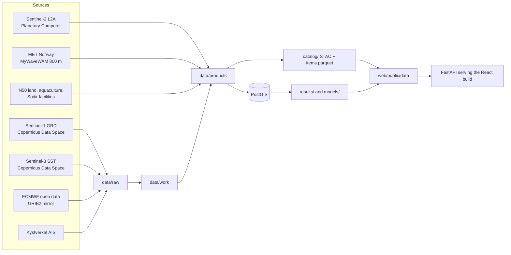

# Architecture

The pipeline turns free satellite and ship-tracking data for the waters off Bergen and Fedje into
ship detections, sea-state values and a searchable catalog. It covers two study periods, summer
(5 August to 30 September 2026) and winter (1 December 2025 to 15 March 2026), and the study box 4.0 to 6.0 E, 60.0 to 61.3 N (`config/pipeline.yaml`).

Terms used throughout:

- SAR, synthetic aperture radar: a satellite radar that sees through clouds and at night. Sentinel-1
  carries one.
- AIS, automatic identification system: radio messages in which ships report their position, speed
  and course.
- COG, cloud-optimized GeoTIFF: an image file that can be read in pieces over the web.
- STAC, SpatioTemporal Asset Catalog: a standard catalog format for satellite data, written as JSON.
- Prefect: the workflow engine that runs every step as a task, with retries, caching and a run history.
- PostGIS: the spatial extension of the PostgreSQL database.
- GDAL: the standard open-source library and command line tools for raster and vector formats.
- GeoParquet: the columnar Parquet table format with a geometry column and its coordinate system.
- NetCDF: a file format for gridded scientific data. CF (Climate and Forecast) conventions standardize
  its variable names, units and coordinates.
- OPeNDAP: a protocol that reads slices of remote NetCDF data without downloading whole files.

## Components

The local stack is defined in `docker-compose.yml`.

| Service | Image | Port on the host | Role |
|---|---|---|---|
| `db` | `postgis/postgis:16-3.4` | 15432 (container 5432) | Passes, detections, AIS, matches, run log, freshness, quality checks |
| `prefect` | `prefecthq/prefect:3-python3.11` | 4200 | Prefect 3 server: API and web UI for flow runs |
| `pipeline` | `msp-pipeline:local`, built from `docker/pipeline.Dockerfile` | none | Runs the `msp` command line and all flows |

The worker image starts from `python:3.11-slim-bookworm`, adds the GDAL command line tools and installs
ESA SNAP 14 (ESA's toolbox for Sentinel data) with the official unattended installer
`esa-snap_sentinel_linux-14.0.0.sh`. SNAP's graph tool `gpt` gets a 6 GB Java heap. The Python package
is installed with the `dev`, `demo` and `ml` extras and a CPU build of PyTorch.

The `pipeline` container mounts the project folder at `/work` and stays idle (`sleep infinity`), so
each stage runs as `docker compose exec pipeline msp <command>`. It reaches the database through
`MSP_DB_URL` and Prefect through `PREFECT_API_URL`. Copernicus Data Space credentials come from the
host environment (`CDSE_USERNAME`, `CDSE_PASSWORD`) and are never written to disk.

## Data flow

1. Ingest flows in `src/msp/flows.py` download raw files, or read only the needed windows (Sentinel-2
   COGs, MET Norway over OPeNDAP).
2. Processing writes products to `data/products` and one STAC item per product to
   `data/work/stac_items`.
3. Detection, AIS ingest and matching write rows to PostGIS (`src/msp/sql/schema.sql`).
4. `msp catalogue` assembles the STAC catalog in `catalog/`. `msp evaluate` and `msp ml train` write
   tables to `results/` and model files to `models/`.
5. `msp demo-export` (`src/msp/demo/export.py`) precomputes everything the website shows into
   `web/public/data`.

## Where files live

Paths are defined in `src/msp/paths.py` relative to the project root (`MSP_ROOT` overrides it).

| Folder | Content |
|---|---|
| `data/raw` | Downloads: SAFE zips, Sentinel-3 zips, GRIB2, raw AIS positions with ship identities, the N50 zip. Never published. |
| `data/work` | Working rasters, CFAR candidates, cut-outs, STAC item files, logs, the vessel hash salt. Never published. |
| `data/products` | Derived products (COG, NetCDF, GeoParquet, Shapefile) described in the catalog |
| `catalog/` | STAC catalog and the GeoParquet item index |
| `results/` | Evaluation tables and JSON summaries written by commands |
| `models/` | `shipnet.pt` and `gradient_boosting.joblib` |
| `web/public/data` | Precomputed JSON, GeoJSON and WebP images for the demo |

## Formats

| Format | Where it is used |
|---|---|
| SAFE (zip) | Sentinel-1 GRD downloads in `data/raw/s1/<pass_id>.zip`, read by SNAP and by the Python fallback through GDAL `/vsizip/` |
| GeoTIFF | 10 m float32 sigma0 working rasters in `data/work/s1/<pass_id>_<engine>.tif` |
| COG | Sentinel-1 sigma0 in dB, Sentinel-2 cloud masks and true-color previews, Sentinel-3 SST previews in degrees Celsius |
| NetCDF (HDF5-based NetCDF-4) | Sentinel-3 L2P input files, and the CF outputs for Sentinel-3 SST, MET Norway waves and wind, ECMWF forecasts |
| GRIB2 | ECMWF forecast messages in `data/raw/ecmwf`, read with cfgrib |
| Shapefile | `land.shp` and `land_buffered.shp` in `data/products/landmask`, and the Sodir facility download |
| GeoParquet | Detection products, CFAR candidates, offshore structures, the catalog index `catalog/items.parquet` |
| STAC JSON | Item files in `data/work/stac_items`, the catalog in `catalog/`, a copy per item in `web/public/data/stac` |

SNAP also writes BEAM-DIMAP (a header file plus one ENVI image per band) inside the container scratch
folder. That intermediate never reaches the project folder (see `docs/sar-processing.md`).

## Demo hosting

The demo needs no database and no keys. `msp demo-export` writes every map layer, table and chart
input as static files. The React front end is built into `web/dist`, and the web build places the
exported data under `web/dist/data`.

`server/app.py` is a small FastAPI server that:

- serves `/assets` with a one-year immutable cache header and `/data` with a one-hour cache header,
- compresses responses over 1 KB with gzip,
- answers `/api/health` with `{"status": "ok"}`,
- returns a file from the build folder when one matches the path, and `index.html` for every other
  path, so client-side routing works.

The build folder is `dist/` next to the server in the deploy package, `web/dist` in the repo, or
whatever `MSP_WEB_DIST` names. Map
overlays are WebP images warped to Web Mercator, placed by MapLibre with four corner coordinates.

## Related documents

- `docs/pipeline.md`: flows, tasks, retries, caching and the replay clock
- `docs/sar-processing.md`: radar processing with SNAP and the Python fallback
- `docs/detection-and-matching.md`: CFAR detection, land masking and AIS matching
- `docs/ship-classifier.md`: the ship classifier
- `docs/catalogue.md`: the STAC catalog
- `docs/operations.md`: freshness, quality checks and the runbook
- `docs/decisions.md`: technical decisions
- `docs/evaluation.md`: evaluation rules
